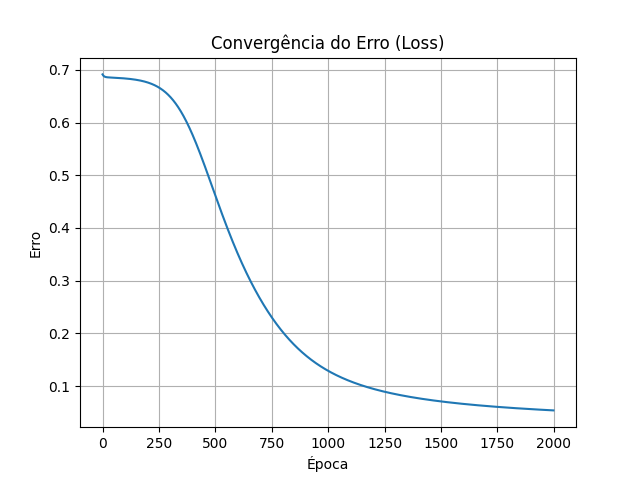

# Detecção de Cédulas Falsas com Rede Neural (implementação do zero)

Rede neural feedforward implementada **do zero em numpy** (sem scikit-learn / sem
frameworks de deep learning) para classificar cédulas bancárias como autênticas
ou falsas, usando o dataset [Banknote Authentication](https://doi.org/10.24432/C55P57)
(UCI Machine Learning Repository).

> Projeto originalmente desenvolvido para a disciplina de Computação Evolucionária
> e Conexionista (UFABC).

## Resultados

| Métrica    | Valor  |
|------------|--------|
| Acurácia   | 0.9781 |
| Precisão   | 0.9690 |
| Recall     | 0.9843 |
| F1-Score   | 0.9766 |



## Sobre a arquitetura

- **Entrada:** 4 neurônios (variance, skewness, curtosis, entropy — features extraídas
  por Transformada de Wavelet a partir de imagens de cédulas)
- **Camada oculta:** 8 neurônios, ativação sigmoid
- **Saída:** 1 neurônio, ativação sigmoid (probabilidade de a cédula ser falsa)
- **Treino:** backpropagation + gradient descent, função de perda Binary Cross-Entropy
- **Pré-processamento:** normalização Z-Score (média/desvio calculados apenas no
  treino, para evitar data leakage) e split treino/teste 80/20 implementado manualmente

## Estrutura do repositório

```
.
├── data/
│   └── data_banknote_authentication.txt   # dataset
├── docs/
│   └── loss_curve_example.png             # gráfico de exemplo usado neste README
├── src/
│   ├── data_loader.py                     # carregamento, split e normalização
│   ├── neural_network.py                  # rede neural (forward/backward/train)
│   ├── metrics.py                         # acurácia, precisão, recall, F1
│   └── main.py                            # orquestra o pipeline (CLI)
├── tests/
│   └── test_metrics.py
├── outputs/                                # gerado ao rodar main.py (ignorado no git)
├── requirements.txt
├── requirements-dev.txt
└── LICENSE
```

## Como executar

### 1. Criar ambiente virtual e instalar dependências

**Linux/macOS**
```sh
python -m venv venv
source venv/bin/activate
pip install -r requirements.txt
```

**Windows**
```sh
python -m venv venv
venv\Scripts\activate
pip install -r requirements.txt
```

### 2. Rodar o treinamento

```sh
python src/main.py
```

Isso vai treinar o modelo, imprimir as métricas no terminal e salvar em `outputs/`:
- `resultado.txt` — métricas de avaliação
- `loss_curve.png` — curva de convergência do erro

### Parâmetros opcionais

```sh
python src/main.py --hidden-size 8 --lr 0.1 --epochs 2000 --test-size 0.2 --seed 42
```

| Flag            | Padrão | Descrição                              |
|-----------------|--------|-----------------------------------------|
| `--data-path`   | `data/data_banknote_authentication.txt` | Caminho do dataset |
| `--output-dir`  | `outputs/` | Onde salvar resultados e gráfico     |
| `--hidden-size` | `8`    | Número de neurônios na camada oculta   |
| `--lr`          | `0.1`  | Taxa de aprendizado                    |
| `--epochs`      | `2000` | Número de épocas de treino             |
| `--test-size`   | `0.2`  | Fração dos dados usada para teste      |
| `--seed`        | `42`   | Seed para reprodutibilidade do split   |
| `--quiet`       | -      | Não imprime o progresso a cada época   |

### 3. Rodar os testes

```sh
pip install -r requirements-dev.txt
pytest tests/
```

## Dataset

O dataset é distribuído pelo UCI Machine Learning Repository:

> V. Lohweg. "Banknote Authentication," UCI Machine Learning Repository, 2012.
> https://doi.org/10.24432/C55P57

## Licença

Este projeto está sob a licença MIT — veja [LICENSE](LICENSE) para mais detalhes.

## Author

Rodrigo Secundo  
Computer Science Student  
GitHub: [@rgustinelli](https://github.com/rgustinelli)